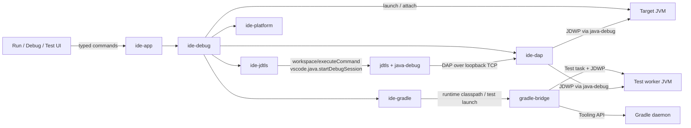

# Debugging and Test Execution

This document defines how the IDE runs and debugs Java programs and tests. It
is the contract between `ide-debug`, `ide-dap`, `ide-jdtls`, `ide-gradle`, the
UI, and the OpenCode integration.

The guiding rule is the same as everywhere else: **do not reimplement the JVM,
Gradle, or JUnit.** Use the JVM's JDWP/JDI through the java-debug adapter, use
Gradle's TestLauncher for Gradle tests, and use jdtls/java-test only where
Gradle cannot provide the behavior.

## 1. Ownership

| Concern | Owner |
| --- | --- |
| Debug session lifecycle, breakpoints, stack/variable view models, launch configs | `ide-debug` |
| DAP framing, request correlation, reverse requests, event fan-out | `ide-dap` |
| Starting the java-debug adapter, Java project metadata, main-class resolution | `ide-jdtls` |
| Runtime/test classpath, test selection, Gradle test task execution | `ide-gradle` + sidecar |
| Process creation, port allocation, process groups, temp files | `ide-platform` |
| Commands, state aggregation, policy, trust | `ide-app` |
| Serializable view models and UI commands | `ide-ui-api` |
| UI rendering and input | `ide-ui-tauri` + `ui/` |
| AI tools and failure context | `ide-mcp`, `ide-context` |

**Not allowed**

- A second Java debugger implementation based on custom JDI code in Rust.
- Parsing `java -agentlib:jdwp=...` output when the DAP adapter can report the
  state.
- Shelling out to a Gradle CLI for test execution when the Tooling API path is
  available.
- Letting the UI speak DAP directly.

## 2. Runtime architecture



### 2.1 Starting the adapter

1. jdtls is launched with the pinned `com.microsoft.java.debug.plugin-*.jar`
   in `initializationOptions.bundles`.
2. `ide-jdtls` sends `workspace/executeCommand` with
   `command: "vscode.java.startDebugSession"`.
3. The result is a TCP port on which the java-debug DAP adapter is listening.
4. `ide-dap` connects to `127.0.0.1:<port>` and performs the DAP handshake.
5. The adapter is owned by the jdtls process. If jdtls dies, the adapter dies;
   the debug session becomes `Failed` and the target process is terminated or
   detached according to policy.

Only loopback connections are allowed. The adapter has no authentication; it
must never be exposed on a public interface. A port returned by the adapter is
validated as a local port and used immediately; do not cache it across jdtls
restarts.

### 2.2 Launch paths

| Use case | Mechanism | Why |
| --- | --- | --- |
| Debug a main class | DAP `launch` with `mainClass`, `projectName`, `classPaths`, `modulePaths`, `javaExec`, `vmArgs`, `args`, `cwd`, `env` | java-debug starts the JVM and owns the JDWP connection; we do not duplicate launch logic |
| Run a main class without debug | Gradle `run`/`JavaExec` task when configured, otherwise direct `java` with the resolved runtime classpath | Preserves build behavior; debug uses the adapter |
| Debug a test | Gradle `Test` task with `debugOptions` enabled (`server=y`, `suspend=y`, loopback, allocated port), then DAP `attach` | Keeps Gradle test configuration and lets java-debug connect as a JDWP client |
| Run a test | Gradle `BuildLauncher` with an init script applying `TestFilter` class/method selection | Preserves test task, toolchain, JVM args, system properties, and plugins; `TestLauncher` is not used because it disables `Test.debugOptions` |
| Attach to a local process | DAP `attach` with `processId` or host/port | Standard JDI attach; explicit user action |
| Remote attach | DAP `attach` with `hostName`, `port`, optional timeout | Same protocol; no hidden network access |
| Debug an arbitrary Gradle `JavaExec` task | Not in v1 | There is no general, safe way to inject JDWP into every custom task; surface a clear limitation |

**Important:** do **not** use `TestLauncher` for IDE test runs.
`TestLauncher.debugTestsOn(port)` uses `server=n`, meaning the test JVM
connects to a listening debugger, while java-debug's attach path uses the JDWP
`SocketAttachingConnector`, meaning the debugger connects to the test JVM.
Worse, Gradle's `TestExecutionBuildConfigurationAction` unconditionally applies
`test.debugOptions { enabled = false }` to `TestLauncher` runs unless
`debugTestsOn` is used, overriding init-script debug settings. The supported
design is `BuildLauncher` plus a generated Gradle init script that:

- applies `TestFilter.includeTest(className, methodName)` and sets
  `failOnNoMatchingTests(false)`,
- disables `upToDateWhen`/`cacheIf` for the selected `Test` task,
- sets the `Test` task's `debugOptions` to `server=true`, `suspend=true`, and an
  IDE-allocated loopback port when debugging.

This was validated live against Gradle 9.8.1 in Phase 0: the test worker opened
a JDWP listener, the client sent the 14-byte `JDWP-Handshake` greeting first,
read the echo, and sent `VirtualMachine.Resume` (command set 1, command 6); the
tests then ran to completion. Reading the handshake before sending the greeting
deadlocks until the worker times out and surfaces as `early eof`. Use a fixed
high debug port rather than releasing an ephemeral port, because Gradle's own
worker-control ports can race the debug listener.

## 3. Launch configurations

### 3.1 File format

Project-local `.javaide/launch.json` (JSONC) is optional and user-owned. User
configurations live in the workspace data directory. The app generates a JSON
Schema and validates on load; unknown fields are reported, not silently
dropped.

```jsonc
{
  "$schema": "https://javaide.invalid/schemas/launch.json",
  "version": 1,
  "configurations": [
    {
      "name": "OrdersApp",
      "type": "java",
      "request": "launch",
      "mainClass": "com.acme.orders.OrdersApp",
      "projectName": "orders",
      "args": ["--port", "8080"],
      "vmArgs": ["-Xmx1g", "-Dspring.profiles.active=local"],
      "cwd": "${workspaceFolder}",
      "env": { "APP_ENV": "local" },
      "console": "internal",
      "stopOnEntry": false,
      "preLaunchTask": ":orders:classes"
    },
    {
      "name": "OrdersApp (remote)",
      "type": "java",
      "request": "attach",
      "hostName": "127.0.0.1",
      "port": 5005,
      "projectName": "orders",
      "timeoutMs": 30000
    },
    {
      "name": "OrderServiceTest",
      "type": "java",
      "request": "launch",
      "test": {
        "projectPath": ":orders",
        "taskPath": ":orders:test",
        "class": "com.acme.orders.OrderServiceTest",
        "methods": ["rejectsInvalidOrder"]
      },
      "vmArgs": ["-ea"]
    }
  ]
}
```

Substitution is explicit and non-recursive:

- `${workspaceFolder}` — canonical root.
- `${file}` — active file path.
- `${fileBasename}`, `${fileDirname}`.
- `${selectedText}` — only for prompt-like fields, never for `mainClass`.
- `${env:NAME}` — read at launch time; never logged.
- `${config:name}` — another configuration's field, one level only.

No shell expansion, globbing, or command substitution. Unknown variables are
errors.

### 3.2 Domain model

```text
LaunchConfiguration
  id, name, request (Launch | Attach), target (Main | Test | Remote)
  mainClass?, projectName?, moduleName?
  testSelection? { projectPath, taskPath, class?, methods? }
  args, vmArgs, cwd, env, console, stopOnEntry, noDebug
  preLaunchTask?, postDebugTask?
  sourcePaths?, classpathMode (Auto | Runtime | Test | Explicit), classpath?
  modulepathMode, modulepath?
  stepFilters { skipClasses, skipSynthetics, skipStaticInitializers, skipConstructors }
  exceptionOptions { caught, uncaught, classFilters, exclusionFilters }
```

`ide-app` resolves the configuration into a `ResolvedLaunch` before starting a
session. Resolution failures are user-facing and typed:

- `main_class_not_found`
- `main_class_ambiguous` (with candidates)
- `classpath_unavailable`
- `project_not_found`
- `jdk_not_found`
- `port_unavailable`
- `prelaunch_failed`

### 3.3 Classpath and JDK resolution

For a Gradle project:

1. Ask `BuildSystem` for the project's runtime/test classpath and Java home.
2. Prefer the project toolchain's Java executable; fall back to the Gradle
   daemon's Java home only with a visible warning.
3. If the classpath is unavailable, offer a sidecar sync; do not guess from the
   filesystem.
4. For a single-file/plain Java project, use the jdtls project model and the
   jdtls-resolved classpath as a fallback.

The classpath is passed to java-debug as `classPaths` (and `modulePaths` for
modular projects). Paths are absolute, deduplicated, and ordered. Long
classpaths use the adapter's `shortenCommandLine` equivalent (`argfile` when
supported) rather than an OS-specific command-line hack.

## 4. DAP client

### 4.1 Framing and lifecycle

`ide-dap` implements the Debug Adapter Protocol over TCP:

```text
Content-Length: <n>\r\n
\r\n
<n bytes of UTF-8 JSON>
```

- One reader task parses frames; one writer task serializes requests.
- Requests are correlated by `seq`/`request_seq`; responses complete a
  `oneshot`.
- Events are broadcast to `ide-debug` and normalized for the UI.
- Reverse requests (`runInTerminal`, `startDebugging`, `handshake`) are handled
  by a policy object. Unknown reverse requests return a DAP error.
- The client enforces per-request timeouts. DAP has no cancellation request;
  cancellation means terminating the session or ignoring a late response.
- The session has a generation ID. Events from an old generation are dropped.

### 4.2 Handshake

```text
initialize { adapterID: "java", clientID: "javaide", linesStartAt1: true,
             columnsStartAt1: true, pathFormat: "path",
             supportsVariableType: true, supportsVariablePaging: true,
             supportsRunInTerminalRequest: true, supportsStartDebuggingRequest: true }
launch | attach
initialized event
setBreakpoints / setExceptionBreakpoints / setFunctionBreakpoints
configurationDone
```

Do not send `configurationDone` until all initial breakpoints are acknowledged.
If the adapter does not emit `initialized`, time out and fail with logs.

### 4.3 Capability detection

Read `initialize` response capabilities and gate UI:

- `supportsConfigurationDoneRequest`
- `supportsConditionalBreakpoints`, `supportsHitConditionalBreakpoints`,
  `supportsLogPoints`
- `supportsSetVariable`, `supportsSetExpression`
- `supportsEvaluateForHovers`, `supportsCompletionsRequest`
- `supportsTerminateRequest`, `supportsRestartRequest`
- `supportsExceptionInfoRequest`, `exceptionBreakpointFilters`
- `supportsStepInTargetsRequest`, `supportsStepBack` (likely false)
- `supportsLoadedSourcesRequest`, `supportsModulesRequest`
- `supportsDelayedStackTraceLoading`, `supportsVariablePaging`
- `supportsHotCodeReplace` if advertised

Never assume a capability because another Java debugger has it.

## 5. DAP feature mapping

| IDE feature | DAP surface | Notes |
| --- | --- | --- |
| Line breakpoints | `setBreakpoints` per source | Stable ID: document URI + line + condition; preserve when moving |
| Conditional breakpoints | `condition` | Java expression; validate cheaply, let the adapter report errors |
| Hit count | `hitCondition` | Pass through; show the adapter's verification result |
| Logpoints | `logMessage` | Do not suspend; interpolate `{expression}` per DAP |
| Exception breakpoints | `setExceptionBreakpoints` + filters | Caught/uncaught, class filters, exclusions |
| Method/field breakpoints | `setFunctionBreakpoints` or custom | Feature-detect; v1 best effort |
| Pause / continue | `pause`, `continue` | Per-thread where supported |
| Step over/in/out | `next`, `stepIn`, `stepOut` | `stepInTargets` when advertised |
| Threads | `threads` | Keep selection stable across stops |
| Call stack | `stackTrace` | Page frames; map source paths |
| Scopes | `scopes` | Locals, arguments, statics (settings) |
| Variables | `variables` | Page children; lazy expansion; cap strings |
| Watches | `evaluate` context `watch` | Persist per session; re-evaluate on stop |
| Hover evaluation | `evaluate` context `hover` | Only when enabled; never auto-run code in a file |
| Debug console | `evaluate` context `repl` | Input history; clear warning that expressions execute |
| Set variable | `setVariable` | Feature-detect; confirm for mutating edits |
| Loaded sources | `loadedSources` | Read-only virtual documents |
| Hot code replace | adapter-specific request/event | Manual/auto setting; fallback to restart |
| Terminate / disconnect | `terminate`, `disconnect` | `terminateDebuggee` only when the user owns the process |

### 5.1 Breakpoint state machine

```text
Pending -> Verified
   |          |
   +-------> Rejected (with reason)
   |          |
   +-------> Moved (adapter returns new line)
```

- Source breakpoints are stored per document URI and line. On file rename, move
  them with the document; on delete, keep them as orphaned until the user
  removes them.
- Re-send all breakpoints after `initialized` and after a jdtls restart.
- `sourceModified` is not trusted blindly; compare the document version and
  show “breakpoint may be stale”.
- A breakpoint in a generated/decompiled source is read-only; show a warning.

### 5.2 Threads, stack, and variables

- Only fetch stack frames for the selected thread; do not poll all threads.
- Preserve expansion state by variable reference where possible.
- Cap variable strings (default 10k chars) and collection children (default
  1k) with “show more”.
- Show type names when enabled; format arrays/collections without executing
  arbitrary user `toString()` unless the adapter does so safely.
- Evaluation results are text; do not render them as trusted HTML.

### 5.3 Hot code replace

- Trigger after a successful build of changed classes while stopped.
- Use the adapter's HCR support if advertised; otherwise offer “Restart
  session”.
- HCR limitations (schema changes, new methods, changed hierarchies) are
  surfaced as adapter errors, not silently ignored.
- Never auto-restart a session without user consent.

## 6. Run configurations and output

- Run/debug toolbar shows the selected configuration, a run/debug split button,
  stop, restart, and a configuration editor.
- Output panel per session:
  - program stdout/stderr,
  - JVM/Gradle output,
  - debug adapter output (collapsible, redacted),
  - exit code and duration.
- Terminal-backed console is opt-in; internal console is the default so the
  session survives focus changes and output is captured.
- `preLaunchTask` runs through `BuildSystem` and blocks launch on failure
  unless `onBuildFailureProceed` is explicitly enabled.
- `postDebugTask` runs after termination, best effort.
- Closing the IDE prompts if debug sessions or test runs are active; the
  default is to terminate owned processes, not orphan them.

## 7. Test model

### 7.1 Discovery

Test discovery must work before the first run, but must not execute user tests
just to list them.

For Gradle projects:

1. Sync the project and identify test source sets/output directories.
2. Ensure test classes are compiled (`testClasses` or a narrower compile task)
   when the user expands the test explorer or explicitly refreshes.
3. Scan compiled `.class` files with ASM in the sidecar:
   - JUnit 5: `@Test`, `@TestFactory`, `@ParameterizedTest`, `@RepeatedTest`,
     nested classes, `@DisplayName`.
   - JUnit 4: `@Test`, `@RunWith`, parameterized runners (show the template).
   - TestNG: `@Test`, groups, data providers (show the template).
4. Read the `SourceFile` and `LineNumberTable` attributes for source locations.
5. Return a test tree with stable IDs; the Rust side maps it to `TestItem`.
6. Re-scan on compile output changes and on explicit refresh; debounce.

Why not use `TestLauncher` for discovery? It has no list-only operation; running
tests to discover them is unacceptable. A bytecode scan is deterministic and
fast enough for the v1 target. For JUnit 5, the scan can be replaced by the
JUnit Platform Launcher later if richer descriptors are needed.

Fallbacks:

- Non-Gradle project: jdtls/java-test plugin discovery if available.
- Unsupported framework/custom runner: show test source classes but mark the
  tree as “run by task only”; do not invent methods.
- Kotlin test classes: out of v1; show source-level items only if a future
  Kotlin adapter provides them.

### 7.2 Stable test identity

```text
TestId =
  buildRootHash
  + projectPath        (":orders")
  + taskPath           (":orders:test")
  + classFqn           ("com.acme.OrderServiceTest")
  + methodName?        ("rejectsInvalidOrder")
  + parameterDisplay?  ("[1] null order")
```

- IDs survive reruns and IDE restarts as long as the source shape is stable.
- Parameterized/dynamic cases get child IDs after execution; the template
  method remains the parent.
- Never key results by display name alone; names are not unique.

### 7.3 Running tests

Normal run:

```text
UI: RunTests(selection)
  → App: validate trust, resolve project/task
  → Gradle: TestLauncher
       .forTasks(":orders:test")
       .withTaskAndTestClasses(task, classes)
       .withTaskAndTestMethods(task, class, methods)
       .withArguments(user args)
       .withCancellationToken(token)
  → Tooling API events: test started / finished / failed / skipped
  → Sidecar: normalize + persist JUnit XML
  → App: update TestRun, Problems, output
  → UI: live tree, counters, duration, failures
```

- Use `withTaskAndTestClasses`/`withTaskAndTestMethods` for v1; they preserve
  the task's configuration and work with Gradle 6.1+.
- Use `withTestsFor` only when fine-grained package/pattern selection is
  needed and the target Gradle is 7.6+.
- `forTasks` is required for multi-module projects and included builds; test
  class/method selection without a task is ambiguous.
- Gradle's test JVM receives the task's configured JVM args, system
  properties, environment, toolchain, and working directory.
- If Gradle reports “no matching tests”, show the selection and the filters; do
  not silently fall back to running the whole suite.
- Test output is streamed; the full log is written to the workspace data dir.
  The UI keeps a bounded tail.

### 7.4 Debugging tests

```text
UI: DebugTests(selection)
  → App: resolve test task and runtime
  → Gradle: allocate loopback port P; write generated init script:
         tasks.withType(Test).configureEach {
           filter {
             includeTest("com.example.AppTest", "addsTwoNumbers")
             setFailOnNoMatchingTests(false)
           }
           upToDateWhen { false }
           cacheIf { false }
           debugOptions {
             enabled = true
             server = true
             suspend = true
             port = P
             host = "127.0.0.1"
           }
         }
  → Gradle: BuildLauncher.forTasks(task)
       .withArguments("--init-script", initScript)
  → Gradle: test worker JVM starts suspended and listens on P
  → App: start java-debug via jdtls; DAP attach { hostName: "127.0.0.1", port: P }
  → DAP: initialized → setBreakpoints → configurationDone
  → Gradle: test worker resumes when the debugger continues
  → Results + DAP events stream to the UI
```

- The init script is generated under the IDE data directory and deleted after
  the run. It is not written into the project.
- Only one test JVM is debugged at a time. Disable parallel forks and
  `forkEvery` for the debug run, or fail with a clear message.
- If attaching fails, terminate the Gradle test build and release the port.
- The test run's result and the debug session are correlated by run ID so the
  UI can show “debugging: OrderServiceTest”.
- Validated against Gradle 9.8.1 in Phase 0. Re-validate on each pinned Gradle
  version; if a version rejects the init script, fall back to a documented “run
  test with `--debug-jvm`”-style manual flow rather than silently degrading.

### 7.5 Test results

```text
TestRun
  id, projectPath, taskPath, selection, state, startedAt, duration
  cases: [TestCaseResult]
  output: bounded log reference
  failures: [TestFailure]

TestCaseResult
  id, displayName, state (Queued|Running|Passed|Failed|Skipped|Errored)
  duration, failure?, outputRef?, sourceLocation?

TestFailure
  message, type, stackTrace, expected?, actual?
  sourceLocation?, stdoutRef?, stderrRef?
```

- Prefer Tooling API test events for live state.
- Use JUnit XML under `build/test-results/<task>/*.xml` for persistence and
  details that events omit.
- Parse XML defensively; malformed XML is a test-infrastructure error, not a
  pass.
- Normalize stack traces to workspace-relative paths and clickable frames.
- Show “rerun failed” using the retained selection; do not rerun passed tests
  unless requested.
- Test output can be huge; keep a tail in memory and a full file on disk.

## 8. Test explorer UI

- Tree: project → test task → package → class → method/parameterized case.
- Status icons: not run, queued, running, passed, failed, skipped, errored.
- Toolbar: run all, run selected, debug selected, rerun failed, stop, refresh,
  filter, collapse.
- Inline actions on test methods in the editor (CodeLens or gutter): run,
  debug, reveal in explorer.
- Test results panel: summary, failures, output, duration, source navigation.
- Problems integration: failed assertions map to test source; infrastructure
  failures map to the build file/task.
- Keyboard: run (Ctrl/Cmd+Shift+F10 or platform equivalent), debug
  (Shift+F9), rerun failed (Ctrl/Cmd+F11).
- Preserve expansion and selection across reruns.

## 9. Debug UI

- Left/right dock: threads, call stack, variables, watches, breakpoints.
- Editor gutter: breakpoint dot, condition/hit-count/logpoint indicator,
  disabled state.
- Debug toolbar: resume, pause, step over/in/out, restart, stop, disconnect.
- Status bar: session name, state, target JVM, “JDWP connected” indicator.
- Inline values: optional, opt-in, feature-detect; never block typing.
- Debug console: monospace, history, evaluate on Enter, clear warning that
  expressions run in the target process.
- Source not found: show “Locate source” and a read-only class view; do not
  silently open a wrong file.

## 10. AI integration

### 10.1 Tools exposed to OpenCode

| Tool | Mutating | Behavior |
| --- | --- | --- |
| `ide_test_results` | no | Latest run for a project/test, bounded failures, source links |
| `ide_run_tests` | **yes** | Run a test selection through Gradle; permission-gated |
| `ide_get_debug_state` | no | Session state, stop reason, selected thread/frame summary; no variables by default |
| `ide_debug_launch` | **yes** | Launch a configured debug session; Phase 3+ and permission-gated |
| `ide_run_gradle_task` | **yes** | Already defined in [OPENCODE.md](OPENCODE.md); can run test tasks but prefer `ide_run_tests` |

Rules:

- Never expose raw DAP or arbitrary JDWP commands.
- Never let the agent set breakpoints, mutate variables, or evaluate expressions
  in v1. Those are user actions, not tool calls.
- Debug state is read-only and bounded; variables may contain secrets. Return
  names/types and only explicitly requested values.
- A test run started by the agent must be attributable in the UI (“OpenCode
  started :orders:test”).
- Tool output includes a one-line summary plus structured data, so the model can
  reason without a full log.

### 10.2 Failure context for prompts

When the user chooses “Explain test failure” or “Fix test failure”:

```text
<test-failure>
project: :orders
task: :orders:test
test: com.acme.OrderServiceTest.rejectsInvalidOrder
result: failed (assertion)
message: expected <400> but was <200>
location: src/test/java/com/acme/OrderServiceTest.java:42
stack:
  at com.acme.OrderServiceTest.rejectsInvalidOrder(OrderServiceTest.java:42)
  ...
relevant source:
  ...bounded snippet around line 42...
</test-failure>
```

- Include the failing assertion and the nearest source, not the entire log.
- Include Gradle/test infrastructure errors separately; do not ask the model to
  “fix” a missing dependency as if it were an assertion.
- Redact environment variables, credentials, and absolute home paths where
  possible.
- The agent can call `ide_test_results` for more, or `ide_run_tests` to verify
  a fix (with permission).
- If the failure is flaky or environment-dependent, say so; do not let the
  model present a guess as a diagnosis.

### 10.3 AI-assisted debugging boundaries

- v1: read-only debug state, test failures, and run output.
- Later: propose a breakpoint or launch configuration as a *suggestion* the
  user applies.
- Never auto-continue a stopped debugger, auto-modify variables, or execute
  arbitrary expressions from model output.
- Any future “agent controls debugger” feature requires a new ADR, explicit
  permission scopes, and an audit trail.

## 11. Failure handling

| Failure | Behavior |
| --- | --- |
| java-debug bundle missing | Disable debug actions; show “Reinstall Java language support”; editing/tests still work |
| `startDebugSession` fails/times out | Kill the adapter process if owned; show logs; retry once |
| DAP connect refused | Release port; report adapter/jdtls state; offer restart |
| Target JVM exits before attach | Show exit code and output; mark run failed, not “debugger error” |
| `launch` rejected | Show adapter message, resolved main class/classpath, and “Edit configuration” |
| Classpath resolution fails | Do not launch; show the Gradle problem and “Sync project” |
| Breakpoint unverified | Keep it visible with the adapter reason; do not pretend it is active |
| HCR fails | Show the adapter error; offer restart; keep the session stopped |
| Test worker never suspends | Timeout; terminate Gradle test build; check init script and port |
| Test selection matches nothing | Show the selected IDs and filters; no fallback to all tests |
| Debuggee hangs | “Stop” terminates the owned process group; “Disconnect” detaches if supported |
| Orphaned test worker | Kill the process group; mark the run failed; clean the temp init script |
| Source file changed during debug | Warn; offer reload; source mapping may be stale |
| Remote connection drops | Mark disconnected; do not auto-reconnect without user action |
| Test XML malformed | Mark infrastructure error; preserve raw file path |

## 12. Security and trust

- Debugging and testing execute project code. Require workspace trust before
  launch, attach, test discovery that compiles, or any evaluate action.
- Bind java-debug, JDWP, and test debug ports to loopback only. Allocate ports
  from the OS, validate them, and close listeners promptly.
- Do not accept a debug port from an untrusted file without user confirmation.
- Terminate owned process groups; never kill an unrelated process by PID.
- Redact environment variables, system properties, and command lines in logs.
- Treat debug console expressions as code execution; make that explicit.
- The OpenCode agent cannot evaluate expressions or mutate debug state in v1.
- Test output may contain secrets; context extraction is bounded and redacted.

## 13. Testing strategy

### Unit

- Launch configuration parsing, variable substitution, validation.
- DAP framing, sequence correlation, reverse request handling.
- Debug session state machine and generation handling.
- Breakpoint identity, movement, and persistence.
- Test ID stability, selection filters, XML parsing, stack normalization.
- Port allocation and cleanup.

### Contract / golden traces

- Recorded DAP `initialize`/`launch`/`stopped`/`stackTrace`/`variables`
  sequences, replayed against a fake adapter.
- Recorded Gradle Tooling API test events and JUnit XML fixtures.
- Assert unknown events are ignored and malformed frames fail closed.

### Integration

Fixtures:

- `debug-main` — main class with arguments, env, working dir.
- `debug-exception` — caught/uncaught exceptions, conditional breakpoints.
- `debug-modular` — module path.
- `debug-remote` — attach to a JVM started by the test.
- `junit5-basic` — pass, fail, skip, parameterized, nested.
- `junit4-basic` — runner and parameterized template.
- `testng-basic` — groups and data provider template.
- `gradle-multi` — tests in `:app` and `:lib`.
- `gradle-test-debug` — verifies the init-script debug path.
- `broken-test-build` — compile failure and missing dependency.

Assertions:

- DAP attach under 3 seconds on a warm adapter.
- Breakpoint hit with correct thread/frame/line.
- Variable expansion and set-variable behavior.
- Test tree count and stable IDs.
- Failed test maps to the correct source line.
- Debug test stops at the test breakpoint and completes.
- Stop/terminate cleans up workers and ports.
- jdtls restart invalidates sessions without crashing the app.

### Nightly matrix

JDK 17/21/25, Gradle 8.5/latest 8.x/latest 9.x, Linux/macOS/Windows. Real
java-debug and jdtls; full suite under 20 minutes.

## 14. v1 limitations and open questions

- Test discovery by bytecode scanning may miss custom runners, suites, and
  generated tests. Show the limitation and provide “run by task”.
- Parameterized and dynamic tests are expanded after execution.
- Arbitrary Gradle `JavaExec` task debugging is not supported in v1.
- Hot code replace support depends on the adapter and JVM; validate.
- Method/field watchpoints and step-back are not v1 commitments.
- Remote attach is explicit and manual; no auto-discovery of JPDA ports.
- Coverage is a later feature; do not conflate it with test results.
- Phase 0 must validate:
  1. java-debug launch/attach against JDK 21.
  2. Gradle `Test` task `debugOptions` with a generated init script.
  3. Test class scanning for JUnit 5/4/TestNG.
  4. DAP reverse requests and process cleanup on Linux/macOS/Windows.
