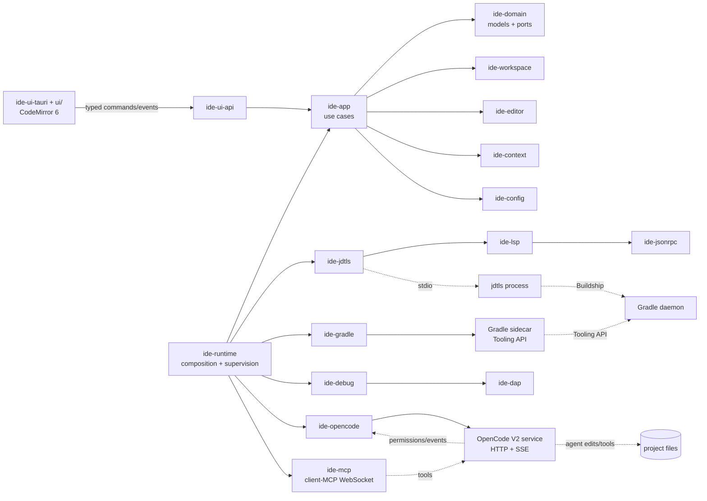

# Master Plan

> Status: **draft for review**. This document is the entry point. Detailed
> contracts live in the linked documents; this page should stay short enough to
> read in one sitting.

## 1. One-paragraph summary

Build a desktop Java IDE whose core is written in Rust and whose Java
intelligence is provided by the Eclipse JDT Language Server (jdtls). The IDE
opens Gradle projects, keeps jdtls and a Gradle Tooling API sidecar in sync,
and provides editing, navigation, refactoring, build, run, test, and debug
workflows. OpenCode V2 is embedded as the AI collaborator: a Rust client talks
to the local OpenCode HTTP/SSE service, the UI renders chat, tool calls,
permissions, and diffs, and the IDE exposes Java-aware tools to the agent over
client-MCP. The core is UI-agnostic and split into small crates so the project
can grow without turning into a monolith.

## 2. Product goals

1. **Open a real Gradle project and be productive in minutes.** Detect JDKs and
   the Gradle wrapper, import the build, show progress/errors, and make code
   intelligence work without editing project files.
2. **Do not reimplement Java.** jdtls is the source of truth for Java parsing,
   indexing, diagnostics, completion, navigation, formatting, and refactoring.
3. **Make Gradle a first-class citizen.** Project model, tasks, dependencies,
   run configurations, tests, cancellation, and build-file change handling.
4. **Make AI a first-class collaborator, not a bolt-on.** The agent sees the
   current file, selection, diagnostics, project model, Gradle failures, and
   test results; edits are reviewable and reversible.
5. **Be modular and documented by construction.** Small crates, explicit ports,
   typed IPC, protocol adapters, decision records, and thorough rustdoc.
6. **Fail safely.** Workspace trust, least-privilege permissions, crash
   recovery, no silent writes to the user's project, and no hidden network
   calls.

## 3. v1 scope

### Must have

| Area | v1 capability |
| --- | --- |
| Workspace | Open folder/workspace, multi-root, recent workspaces, trust prompt |
| Editing | Tabs, split editors, undo/redo, multi-cursor, search/replace, save, external-change handling, syntax highlighting, folding, bracket matching |
| Java intelligence | Diagnostics, completion, hover, signature help, definitions, references, implementations, symbols, rename, code actions, formatting, organize imports, semantic tokens, inlay hints, call/type hierarchy, code lens |
| Gradle | Wrapper/JDK detection, import, multi-module and composite builds (best effort), project/task tree, task execution/cancel, dependency view, build-file watching, error surfacing, offline mode |
| Run | Run main class or Gradle application task, environment/VM args, working directory, output panel |
| Test | JUnit 4/5/6 and TestNG discovery, run class/method, results tree, stack navigation, rerun failed |
| Debug | DAP launch/attach, breakpoints (conditional/log), stepping, threads, stack, variables, watches, evaluate, exception breakpoints, hot code replace |
| OpenCode | Service discovery/start, sessions, streaming chat, agents/models, context injection, permission prompts, tool calls, diff view, revert, saved approvals |
| Quality | Crash recovery, jdtls restart, Gradle daemon awareness, logs, settings UI, keyboard-first workflows |
| Packaging | Linux, macOS, Windows; bundled or provisioned jdtls and JDK; signed installers |

### Later (not v1 blockers)

Maven task/run parity (jdtls already provides basic Maven intelligence), Kotlin
DSL and Groovy build-script intelligence, Android, Spring Boot dashboards,
profilers, decompiler UI, remote development, plugin marketplace, full Git
client, AI inline completion, multi-agent orchestration, worktree management.

### Explicit non-goals

- Reimplementing javac, a Java parser, or a Gradle build engine.
- Bit-for-bit compatibility with VS Code or IntelliJ project formats.
- Supporting every Gradle plugin; support the standard JVM ecosystem first.
- Autonomous AI operation by default. "Allow always" is explicit and scoped.

## 4. Architecture at a glance

**Ownership rules**

- **jdtls** owns Java semantics and the Java project model used for language
  features.
- **Gradle sidecar** owns build/task/test models and runtime classpaths.
- **OpenCode** owns AI sessions, model/provider credentials, prompts, agent
  loops, and permission evaluation. The IDE owns the context it sends, the UI
  for approvals, and Java-specific tools.
- **The app core** owns editor state, workspace state, document lifecycle, and
  command orchestration.
- **UI adapters** own presentation only. They never speak LSP, DAP, Gradle, or
  OpenCode directly.

## 5. Key decisions

| Decision | Choice | Rationale | ADR |
| --- | --- | --- | --- |
| UI stack | **Tauri 2 + CodeMirror 6** recommended for v1; core remains UI-agnostic | Mature editing/IME/accessibility, fastest path to a usable IDE; native UI can follow | [0001](ADR/0001-ui-stack.md) |
| Java intelligence | jdtls as a managed child process | Avoids reimplementing Java; proven by VS Code/Theia/Neovim | [0003](ADR/0003-jdtls-source-of-truth.md) |
| Gradle | Java sidecar using the Gradle Tooling API | Structured models/events/cancellation; no CLI parsing | [0002](ADR/0002-gradle-integration.md) |
| OpenCode | Connect to the local V2 HTTP/SSE service; Rust client | Language-agnostic, shared sessions/auth, keeps UI replaceable | [0004](ADR/0004-opencode-integration.md) |
| IDE tools for agents | OpenCode **client-MCP** WebSocket | First-party V2 mechanism; no config edits; tools scoped to a location/session | [0004](ADR/0004-opencode-integration.md) |
| AI edits | Disk writes by OpenCode, IDE watcher + diff/revert | Works with native agent tools; reversible via session diff/revert | [0005](ADR/0005-ai-edit-policy.md) |
| Text model | Rust-owned rope; UTF-8 byte offsets inside, LSP UTF-16 at the boundary | One source of truth; avoids text bugs in the core | [0006](ADR/0006-text-model.md) |
| Config | TOML settings; JSONC launch configs; generated schemas | Human-friendly, typed, validatable | — |
| Storage | Per-workspace data dir + JSON state; no database in v1 | Simpler; add indexing only when measured | — |
| Packaging | Bundle jdtls + JRE; bundle OpenCode in a later phase | Reliable first run; avoids “works on my machine” | — |

## 6. Workstreams

1. **Core platform** — domain types, ports, command/event bus, settings,
   persistence, process supervision, logging, trust.
2. **Editor and workspace** — text model, viewport, syntax, files, watchers,
   search, save/external-change semantics.
3. **jdtls** — provisioning, launch, LSP client, jdtls-specific settings,
   custom protocol, health/restart, feature mapping.
4. **Gradle** — sidecar, sync, model cache, task/test execution, dependency
   view, JDK/toolchain/wrapper, compatibility.
5. **Run/debug/test** — run configs, output, terminal, DAP, test explorer.
6. **OpenCode** — service manager, HTTP/SSE client, sessions, context bundle,
   client-MCP tools, permissions/forms, diffs/revert, chat UI.
7. **UI/UX** — layout, command palette, keybindings, problems, settings,
   accessibility, themes.
8. **Release engineering** — installers, signing, updates, notices, CI matrix,
   performance budgets.

## 7. Milestones

| Phase | Duration | Outcome |
| --- | --- | --- |
| 0. Walking skeleton | 2 weeks | jdtls + Gradle sidecar + OpenCode stream proven from Rust |
| 1. IDE shell + LSP core | 4–6 weeks | Edit/navigate a Java project; diagnostics/completion/formatting |
| 2. Full jdtls coverage | 4–6 weeks | Feature matrix complete; project import robust |
| 3. Gradle | 4–5 weeks | Real multi-module build, tasks, dependency view, sync |
| 4. Run + test | 3–4 weeks | Run main classes; JUnit explorer; results |
| 5. Debugger | 4–5 weeks | Launch/attach, breakpoints, variables, evaluate |
| 6. OpenCode depth | 4–6 weeks | Context, tools, permissions, diffs, inline actions |
| 7. Hardening + release | 3–4 weeks | Installers, performance, trust, docs, beta |

Calendar estimate with **2 experienced engineers**: **8–10 months** for a
credible v1, with OpenCode core available from Phase 1 and deepened throughout.
A solo engineer should plan **14–18 months**. A narrow, scope-reduced MVP
(single-module Gradle, core LSP, run/tests, basic OpenCode chat) is achievable
in **12–16 weeks** with parallel work. See [ROADMAP.md](ROADMAP.md) for the MVP
scope and phase exit criteria.

## 8. Risks and mitigations

| Risk | Impact | Mitigation |
| --- | --- | --- |
| jdtls/Gradle/Buildship version incompatibilities | Import fails, bad diagnostics | Pin a tested matrix; integration fixtures; feature flags; surface upstream errors; test Gradle 8.5–9.x |
| Duplicate/competing build models (jdtls vs sidecar) | Wrong classpath, confusing UI | Explicit ownership; correlate by root path; prefer jdtls for Java semantics, sidecar for build/task/runtime; warn on divergence |
| OpenCode V2 API is marked experimental in places | Breakage between releases | Isolate in `ide-opencode`; OpenAPI snapshot; contract tests; feature detection; version range; degrade to “assistant unavailable” |
| Agent edits bypass unsaved buffers | Lost edits/conflicts | Autosave/warn before prompt; watcher conflict detection; session diff/revert; later route edits through IDE tools |
| Permission fatigue or unsafe autonomy | User harm | Workspace trust; ask by default for edit/shell; explicit allow-always; redaction; no auto-approval |
| Context leaks secrets or huge files | Privacy/cost | Context builder allowlist/redaction/token budget; preview; never auto-send whole repo |
| LSP UTF-16/offset bugs | Corrupted edits | One text model; property tests; golden traces; versioned apply-edit |
| JVM memory/daemon leaks | Slow machine, crashes | One jdtls per workspace; bounded heaps; health checks; clear storage; daemon diagnostics |
| Native UI scope creep | Slipped schedule | Tauri v1; UI-agnostic core; revisit native only after v1 |
| Packaging/signing complexity | Can't ship | Produce unsigned CI artifacts early; automate installers before feature freeze |
| License/notice mistakes | Legal risk | SBOM, notices, EPL/Apache/MIT review, no modified redistribution without source |

## 9. Definition of done for v1

- A new user can install the IDE, open a multi-module Gradle project with a
  wrapper, see diagnostics and completion, run a task, run tests, and debug a
  main class.
- OpenCode is available from the same window: create a session, ask a question
  with the current selection and diagnostics attached, approve/deny tool
  actions, review a diff, and revert a turn.
- A jdtls crash or Gradle sync failure is visible, recoverable, and does not
  lose unsaved editor content.
- No Eclipse metadata is written into the project by default.
- Linux, macOS, and Windows builds pass the same smoke suite.
- Every public API has rustdoc; every protocol adapter has a contract test;
  every architectural decision has an ADR.
- Performance budgets in [ENGINEERING.md](ENGINEERING.md) are met on the
  reference fixture.

## 10. Immediate next step: Phase 0 spike

Before building the shell, prove the three integration risks:

1. **jdtls:** launch a pinned jdtls with JDK 21 against a fixture Gradle
   project, complete `initialize`, receive diagnostics, apply a
   `workspace/applyEdit`, and restart cleanly.
2. **Gradle:** connect the Tooling API sidecar to the same fixture, return a
   project/task model, run `test`, and cancel a running task.
3. **OpenCode:** discover the V2 service, create a location-scoped session,
   stream events, expose one client-MCP tool, and answer a permission request.

Record the traffic as fixtures. Those recordings become the first integration
tests and the seed of the protocol modules. If any spike fails, adjust the ADR
before writing the UI.

## 11. Open questions

1. **UI stack:** confirm Tauri 2 + CodeMirror 6 vs. a pure-Rust GPUI shell. The
   core plan is unchanged; only the UI adapter and schedule differ.
2. **OpenCode distribution:** require a user-installed `opencode` V2 binary for
   the beta, or bundle it from day one?
3. **v1 build systems:** Gradle-only build UX, or also a Maven task runner?
4. **Licensing:** project license and whether the app will be open source.
5. **Minimum OS versions** and whether to support Linux ARM64 at launch.
6. **AI defaults:** which bundled agents/skills and which permission preset
   ships as the recommended default.
