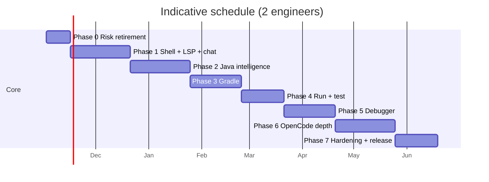

# Roadmap

This roadmap turns [PLAN.md](PLAN.md) into phases with demonstrable exit
criteria. Durations are estimates for **two experienced engineers working in
parallel**, not promises. A solo engineer should use the same phase order but
expect roughly **1.6–1.8×** the calendar time.

> OpenCode is not a final-phase feature. Its service contract is proven in
> Phase 0, its chat UI exists in Phase 1, and its context/tool/diff surfaces
> grow with the Java, Gradle, run, and test work. That ordering keeps the
> assistant honest: it can only see capabilities the IDE actually has.

## 1. Guiding constraints

1. **Prove integrations before building a shell.** Phase 0 retires the three
   highest-risk dependencies: jdtls, Gradle Tooling API, and OpenCode V2.
2. **Every phase ends in a usable build.** No phase is a pure refactor with no
   user-visible result.
3. **Quality is a phase deliverable.** Tests, rustdoc, architecture checks, and
   docs are part of “done”, not a Phase 7 cleanup.
4. **One owner per fact.** jdtls owns Java semantics; Gradle owns build/test
   execution; OpenCode owns AI sessions; the IDE owns editor/workspace state.
5. **No silent degradation.** If an integration is unavailable, the UI says so
   and the rest of the IDE remains usable.

## 2. Phase overview

| Phase | Focus | Effort | Key outcome |
| --- | --- | --- | --- |
| 0 | Risk retirement / walking skeleton | 2 weeks | Rust talks to jdtls, Gradle, and OpenCode; traces recorded |
| 1 | IDE shell + OpenCode chat + basic LSP | 4–6 weeks | Edit, navigate, see diagnostics, and chat with OpenCode |
| 2 | Complete Java intelligence | 4–6 weeks | Full jdtls feature surface and robust project import |
| 3 | Gradle depth | 4–5 weeks | Multi-module sync, tasks, dependencies, build-file changes |
| 4 | Run and test | 3–4 weeks | Run main classes; discover/run/debug tests |
| 5 | Debugger | 4–5 weeks | Full DAP debugging for main classes and tests |
| 6 | OpenCode depth | 4–6 weeks | Context, MCP tools, permissions, diffs, inline actions |
| 7 | Hardening and release | 3–4 weeks | Installers, performance, accessibility, beta |

**Critical path:** 0 → 1 → 2 → 3 → 4 → 5 → 6 → 7. OpenCode work runs in
parallel from Phase 0 but lands in the same phases as the IDE capability it
depends on. Debugging (Phase 5) is the most compressible only by cutting scope,
not by starting earlier.

The dates are placeholders to show sequence; replace them with actual sprint
dates when work starts.

## 3. Phase 0 — Risk retirement (2 weeks)

**Goal:** prove the architecture with the smallest possible Rust program and
record the protocol traffic that becomes the first contract tests.

### Deliverables

- Cargo workspace with the minimum crates needed for the spike:
  `ide-jsonrpc`, `ide-domain`, `ide-jdtls`, `ide-gradle`, `ide-opencode`,
  `ide-platform`, and a small `spike` binary (not the final app).
- `ide-jsonrpc`: Content-Length framing, JSON-RPC request/response/error
  envelope, request correlation, cancellation, and unit tests.
- jdtls:
  - provision or point at a pinned jdtls + JDK 21;
  - launch with the correct arguments and a writable `-data` directory;
  - `initialize`, receive `language/status: ServiceReady`, open a file, receive
    diagnostics, apply one `workspace/applyEdit`, shut down cleanly.
- Gradle:
  - `sidecar/gradle-bridge/` Java 21 project using the Tooling API;
  - connect to a wrapper build, return a project/task model, run `test`, and
    cancel a running task;
  - JSON-RPC over stdio with streaming events.
- OpenCode:
  - discover or start a V2 service, call `/api/info`;
  - create a location-scoped session, send a prompt, stream SSE events;
  - attach a client-MCP WebSocket and answer one tool call;
  - reply to one permission request.
- Recorded traces under `fixtures/traces/` for all three integrations.
- ADRs 0001–0006 reviewed; any spike result that contradicts them updates the
  ADR before the phase closes.
- CI skeleton: fmt, clippy, unit tests, docs, architecture check.
- A one-page `docs/PHASE0_REPORT.md` with versions, commands, failures, and
  decisions.

### Exit criteria

- A single command starts the spike, opens the fixture project, prints
  diagnostics, runs a Gradle task, and streams an OpenCode response.
- No protocol traffic is parsed from a shell string or a log line.
- jdtls, Gradle, and OpenCode versions are pinned and recorded.
- The OpenCode service can be absent and the spike still runs the Java/Gradle
  parts.
- Gradle test debugging connector direction is validated (see
  [DEBUG_TEST.md](DEBUG_TEST.md) §7.4); if the init-script approach fails, the
  test-debug plan is revised before Phase 4.

### Not in Phase 0

- Tauri, real UI, editor, syntax highlighting.
- Full LSP feature coverage.
- Full Gradle model, dependency graph, test discovery.
- OpenCode chat UI, context injection, diff/revert, IDE MCP tools beyond hello.

## 4. Phase 1 — IDE shell, basic LSP, and OpenCode chat (4–6 weeks)

> **Status (2026-10-31):** the usable core is in place. Edit/save, diagnostics,
> completion, hover, definition, format, organize imports, workspace trust,
> Java settings, the command palette, a split editor, and Gradle
> compile/run/test all work from the shell. Multi-root workspaces and the
> generated TypeScript command bindings remain. See
> [PHASE1_STATUS.md](PHASE1_STATUS.md).

**Goal:** a real window that opens a Java workspace, edits files, navigates, and
hosts a streaming OpenCode conversation.

### Deliverables

- `ide-runtime` composition root and `ide-desktop` binary; Tauri 2 shell.
- `ui/`: layout, tabs, split editors, file tree, command palette, status bar,
  settings shell, theme, keyboard map.
- `ide-editor`: rope, line index, UTF-8/UTF-16 conversion, selections,
  multi-cursor, undo/redo, syntax highlighting (tree-sitter), folding.
- `ide-workspace`: document store, open/save, atomic writes, watchers,
  external-change handling, recent workspaces, trust prompt.
- `ide-lsp` + `ide-jdtls`: initialize, document sync, diagnostics, hover,
  definition, completion (basic), formatting, shutdown/restart.
- `ide-ui-api`: typed commands/events, `ts-rs` bindings, protocol version.
- `ide-config`: settings load/save and jdtls mapping for the implemented
  features.
- OpenCode:
  - service discovery/health and `AssistantService` adapter;
  - chat panel with session create/restore, streaming text, stop, agent/model
    picker, error states;
  - SSE reconnect that refetches session context;
  - no context injection or IDE tools yet.

### Exit criteria

- Open a single-module Gradle fixture, edit a `.java` file, save, and see
  diagnostics after jdtls is ready.
- Completion, hover, and go-to-definition work for JDK and project types.
- A jdtls crash is visible and recoverable; unsaved buffers survive.
- The app runs on Linux and macOS developer machines; Windows builds in CI.
- OpenCode chat streams a response and can be stopped without freezing the UI.
- A workspace with OpenCode disabled has no assistant errors in the logs.
- `cargo xtask check-architecture`, clippy, rustdoc, and TS binding checks pass.

### Not in Phase 1

- Rename, code actions, semantic tokens, call hierarchy, and code lens (done in Phase 2).
- Multi-module Gradle model, tasks, tests, debug.
- OpenCode context/permissions/MCP tools/diffs.

## 5. Phase 2 — Complete Java intelligence (4–6 weeks)

> **Status (2026-11-01):** the language-server matrix for this phase is in the
> shell, including semantic tokens, inlay hints, folding, selection ranges,
> call and type hierarchy, code lens, `jdt://` documents, multi-root import,
> and a version-checked `workspace/applyEdit` path. The OpenCode permission
> inbox replies `once` / `always` / `reject` and refreshes after reconnect.
> Still ahead inside the phase: the assistant context bundle, forms, and
> broken-build import UX. See [PHASE2_STATUS.md](PHASE2_STATUS.md).

**Goal:** the jdtls adapter is feature-complete for v1 and robust against real
projects.

### Deliverables

- Full LSP feature matrix from [JDTLS.md](JDTLS.md) §9.4:
  - signature help, references, implementations, type definitions;
  - document/workspace symbols, call/type hierarchy;
  - rename with preview, code actions/resolve, source actions;
  - formatting, range formatting, organize imports;
  - semantic tokens, inlay hints, folding, selection ranges, code lens;
  - decompiled/class file contents and source attachment navigation.
- `workspace/applyEdit` pipeline: validation, version checks, atomic grouped
  edits, overlap rejection, undo integration, clear failure UI.
- Project import robustness:
  - multi-root workspaces;
  - plain Java, single-module Gradle, multi-module Gradle;
  - broken builds, missing JDK, Unicode/CRLF files;
  - jdtls restart with document replay and stale diagnostic handling.
- Settings: all Java settings in [JDTLS.md](JDTLS.md) §7, workspace
  configuration responses by section, restart-required notices.
- Problems panel: file and project diagnostics, source labels, filters.
- OpenCode:
  - context bundle (active file, selection, diagnostics, project metadata);
  - file attachments with mention ranges;
  - permission inbox and reply flow (`once`/`always`/`reject`);
  - forms/questions;
  - session restore and context rehydration after reconnect.

### Exit criteria

- The feature matrix passes integration tests against the pinned jdtls.
- Rename/format/organize-imports apply atomically and are undoable as one step.
- A stale edit is rejected, not applied to newer text.
- A jdtls restart does not lose editor content or duplicate diagnostics.
- OpenCode can explain the current selection with diagnostics attached; the
  context preview shows what will be sent.
- Permission prompts can be approved, denied, and saved; a reconnect restores
  pending requests.
- No Eclipse metadata is written into the project by default.

### Not in Phase 2

- Gradle task execution, dependency view, test explorer, debug.
- OpenCode IDE MCP tools and diff/revert.

## 6. Phase 3 — Gradle depth (4–5 weeks)

**Goal:** Gradle is a first-class build system, not just a project importer.

### Deliverables

- `gradle-bridge` production contract:
  - sync, cancel, runTask, resolveClasspath, dependencyReport, shutdown;
  - progress/output/test events; typed errors;
  - one persistent process per root build; included-build support.
- `ide-gradle`: model cache, serialized syncs, build-file watcher, offline mode,
  JDK/toolchain/wrapper detection, compatibility checks.
- UI:
  - Gradle project/task tree, favorites/recent, task picker;
  - task output panel with cancellation and structured failures;
  - dependency view with conflict/requested/selected and source/javadoc status;
  - build-file error navigation;
  - “sync project” and “open build file” actions.
- Coordination with jdtls: single-flight reimport after build-file changes,
  model correlation, divergence warnings.
- OpenCode:
  - IDE MCP tools: `ide_workspace_info`, `ide_open_editors`,
    `ide_selection`, `ide_diagnostics`, `ide_gradle_model`,
    `ide_run_gradle_task`, `ide_open_location`, `ide_refresh_java_project`;
  - diff/revert for agent edits (`/diff`, `/revert/stage`, `/revert/commit`,
    `DELETE /revert`);
  - external-change conflict UI.
- Gradle test discovery design and spike (full run/test UX in Phase 4).

### Exit criteria

- Open a multi-module fixture with a wrapper, sync it, and run a task with
  streamed output; cancel works.
- Build-file edit triggers one debounced sync and one jdtls reimport; no loop.
- Dependency view resolves one configuration on demand and shows a conflict.
- A broken subproject does not hide the rest of the tree.
- OpenCode can call the Gradle model and run a task through MCP; the IDE shows
  the permission prompt and the task result.
- An agent edit is visible in the diff view and can be reverted without
  touching unrelated changes.
- Offline mode and a missing wrapper produce actionable errors.

### Not in Phase 3

- Test explorer and test debugging.
- Full Kotlin/Groovy build-script intelligence.
- Arbitrary Gradle task debugging.

## 7. Phase 4 — Run and test (3–4 weeks)

**Goal:** run Java programs and tests, with a test explorer backed by Gradle.

### Deliverables

- Run configurations: main class, Gradle task, test, remote attach (config
  model; attach UI can follow in Phase 5).
- `ide-gradle` test discovery: compile test classes, bytecode scan for JUnit
  5/4/TestNG, stable IDs, source locations, refresh.
- Test execution via `TestLauncher`:
  - class/method selection, multi-module task paths;
  - cancellation, live results, JUnit XML persistence;
  - rerun failed, output capture, stack normalization.
- Test explorer UI, gutter/CodeLens run actions, results panel, failure
  navigation.
- Output/run panel for main classes and Gradle tasks.
- OpenCode:
  - `ide_test_results`, `ide_run_tests`;
  - test-failure context bundle and “Explain/Fix test failure” commands;
  - attribution when the agent starts a run.
- Test debug launch path (init script + DAP attach) can be exercised here, even
  if the full debugger UI lands in Phase 5.

### Exit criteria

- Run a main class with args/env/cwd and see output/exit code.
- Discover and run JUnit 5, JUnit 4, and TestNG fixtures; failures map to source.
- Parameterized/nested tests have stable parent IDs and expand after execution.
- Debug a single test to a breakpoint (basic DAP UI may be minimal).
- Rerun failed runs only the failed selection.
- OpenCode can read a failure and run the selected tests with permission.
- Test discovery under 5 seconds for a 1,000-class fixture; test startup does
  not block the editor.

### Not in Phase 4

- Full debugger UI, watches, evaluate, hot code replace.
- Coverage, flaky-test detection, test impact analysis.

## 8. Phase 5 — Debugger (4–5 weeks)

**Goal:** a complete Java debugging experience for main classes and tests.

### Deliverables

- `ide-dap` production client: framing, correlation, reverse requests,
  timeouts, event normalization, generation handling.
- `ide-debug`:
  - java-debug adapter startup via jdtls;
  - launch main class with resolved Gradle runtime classpath;
  - attach local/remote, process picker;
  - source/conditional/hit-count/logpoint breakpoints, exception breakpoints;
  - threads, stack, scopes, variables, watches, evaluate, set variable;
  - step over/in/out, pause/continue, terminate/disconnect;
  - hot code replace (feature-detect) and restart fallback;
  - test debug via Gradle `debugOptions` init script.
- Debug UI: toolbar, gutter, threads/stack/variables/watches/breakpoints,
  console, status bar, source-not-found handling.
- OpenCode:
  - `ide_get_debug_state` read-only tool;
  - “Explain this stop/exception” action with bounded stack/variables;
  - no agent mutation of debug state.
- Process/port cleanup, crash recovery, logs.

### Exit criteria

- Debug a main class with args/env/module path; hit conditional and logpoint
  breakpoints; inspect/expand/set variables; evaluate an expression.
- Debug a test at a breakpoint; test results still report correctly.
- Attach to a remote JVM over loopback and detach without killing it.
- Hot code replace either works or clearly offers restart; no silent failure.
- Killing jdtls/adapters leaves no orphaned debuggee or test workers.
- OpenCode can explain a stop using read-only state, with secrets redacted.
- Debug UI meets keyboard and accessibility checks.

### Not in Phase 5

- Reverse debugging, method/field watchpoints as commitments, arbitrary
  `JavaExec` task debugging.
- Agent-controlled debugger actions.

## 9. Phase 6 — OpenCode depth (4–6 weeks)

**Goal:** move from “chat panel” to an assistant that is native to the IDE
workflow.

### Deliverables

- Context quality:
  - project outline, open editors, Gradle model summary, recent failures;
  - token budgeting, redaction report, preview, “N items omitted”;
  - selection + diagnostics freshness.
- Inline actions from editor, Problems, Gradle, and test panels:
  explain, fix, refactor, generate tests, review changes, diagnose failure.
- Permission/saved-approval management UI, project-scoped patterns, audit view.
- Diff review: per-file, additions/deletions, open in editor, accept/revert,
  staged revert, conflict handling.
- Session tools: fork, compact, export/import, history search, token stats.
- Reconnect polish: SSE gaps, busy/permission race, service restart, draft
  preservation.
- Optional first-party plugin (`opencode-plugin/`) as client-MCP fallback and
  Java command/skill provider.
- Agent edit policy refinements based on measured conflicts.

### Exit criteria

- A full flow works end to end: ask → context preview → tool call → permission
  → file edits → diff → revert.
- Context is bounded and redacted; sensitive files are omitted by default.
- Permission “always” is explicit, scoped, and revocable; deny cannot be
  overridden.
- Reconnect during a prompt restores transcript, pending permissions, and
  forms without duplication.
- The plugin fallback works when client-MCP is disabled.
- No prompt/tool output is written to logs.

### Not in Phase 6

- Bundling OpenCode (Phase 7 decision).
- Autonomous multi-agent orchestration.
- Inline completions (post-v1).

## 10. Phase 7 — Hardening and release (3–4 weeks)

**Goal:** a beta that installs, survives real projects, and can be supported.

### Deliverables

- Packaging:
  - Linux (deb/rpm/AppImage or Tauri equivalents), macOS (dmg, notarized),
    Windows (msi/nsis);
  - bundled/provisioned jdtls + JRE; OpenCode distribution decision;
  - signed installers, checksums, SBOM, third-party notices.
- Performance:
  - startup, open workspace, keystroke latency, completion, Gradle sync, test
    discovery, debug attach;
  - memory guardrails and a low-memory profile;
  - large-file and large-project fixtures.
- Reliability:
  - crash recovery, restart matrices, log export, diagnostics bundle;
  - offline mode, proxy, corporate JDK/Gradle locations.
- UX/accessibility:
  - keyboard-only flows, screen-reader labels, contrast, focus, IME;
  - onboarding, trust dialog, error copy, empty states.
- Documentation:
  - user guide, troubleshooting, supported versions, privacy/security.
- Release:
  - CI release pipeline, versioning, update channel, rollback.
- Final ADR review; remaining open questions resolved or explicitly deferred.

### Exit criteria

- Clean install → open multi-module Gradle project → edit → run task → run tests
  → debug → chat with OpenCode → review/revert a diff on Linux, macOS, Windows.
- No P0/P1 bugs in the smoke suite; performance budgets met on the reference
  fixture.
- Installers are signed; notices/SBOM complete; no secrets in logs.
- A new user can recover from a missing JDK, missing wrapper, jdtls crash, or
  OpenCode service failure without reading source code.
- Beta feedback loop and crash/log export are in place.

## 11. MVP slice (12–16 weeks)

A narrow, credible MVP for two engineers is **not** all of Phases 0–7. It is a
scope-reduced path through the same architecture:

| Included | Reduced/omitted |
| --- | --- |
| Single-module Gradle project with wrapper | Multi-module/composite, dependency view |
| Editor, tabs, save, diagnostics, completion, hover, definition, format | Rename, hierarchy, code lens, inlay hints, semantic tokens |
| Gradle sync, task list, run task, cancel | Build-file error mapping depth, offline/proxy polish |
| Run main class, run tests (JUnit 5), basic results | JUnit 4/TestNG, test debug, parameterized UI |
| OpenCode chat, streaming, stop, context for active file | Permissions UI depth, MCP tools, diff/revert, forms |
| Linux/macOS dev builds | Signed Windows/macOS release installers |

**Exit criteria for the MVP:** a developer can open a real single-module Gradle
project, edit Java with diagnostics/completion, run a Gradle task, run a JUnit 5
test, and ask OpenCode about the current file — without the IDE crashing or
losing content.

This slice is achievable in 12–16 weeks only with parallel work and the
reductions above. The full v1 remains the 8–10 month plan.

## 12. Workstreams and staffing

### Two engineers

| Engineer | Primary ownership |
| --- | --- |
| A — platform/UI | `ide-domain`, `ide-jsonrpc`, `ide-editor`, `ide-workspace`, `ide-config`, `ide-app`, `ide-ui-api`, Tauri/UI, packaging |
| B — language/build | `ide-lsp`, `ide-jdtls`, `ide-gradle`, sidecar, `ide-dap`, `ide-debug`, `ide-platform`, integration fixtures |

OpenCode is shared: A owns the chat/diff/permission UI and `ide-ui-api`; B owns
`ide-opencode`, `ide-mcp`, service lifecycle, and contract tests. Neither
workstream can block the other for more than a day; use the fake/disabled
adapters in `ide-testkit` to keep moving.

### Solo engineer

Use the same order but:
- defer OpenCode MCP tools and diff/revert until after basic chat;
- defer multi-module/composite Gradle and the dependency view;
- ship Linux first, then macOS, then Windows;
- budget 14–18 months for full v1 and 16–20 weeks for the MVP slice.

### Three engineers

Add a dedicated UI/UX engineer in Phase 1 and a release/QA engineer in Phase 5.
This compresses calendar time modestly (roughly 15–20%), not linearly; protocol
and integration risk remain the critical path.

## 13. Quality gates for every phase

A phase is not complete until:

- The phase's integration tests pass on Linux and macOS; Windows is green in CI
  or has a tracked, time-boxed exception.
- `cargo fmt`, `clippy -D warnings`, `cargo test`, rustdoc, `cargo-deny`, and
  `xtask check-architecture` pass.
- New public APIs have rustdoc; new boundaries have an ADR or an update to an
  existing one.
- TypeScript bindings are regenerated and committed.
- No protocol types leak outside their adapter crate.
- Performance does not regress beyond the budgets in
  [ENGINEERING.md](ENGINEERING.md).
- The phase demo works from a clean workspace, not a developer's warm cache.
- Known limitations are documented in the relevant doc and in the UI where a
  user will hit them.

## 14. Risk gates

These are stop/go checkpoints; do not proceed on hope.

| Gate | When | Question | If “no” |
| --- | --- | --- | --- |
| G0 jdtls | End of Phase 0 | Can we initialize, diagnose, apply an edit, and restart reliably? | Change adapter strategy before UI work; consider a different Java LSP only with a new ADR |
| G0 Gradle | End of Phase 0 | Does the sidecar return a model, run/cancel a task, and survive a broken build? | Fall back to init-script JSON for a subset; revisit ownership |
| G0 OpenCode | End of Phase 0 | Can we discover/start V2, stream events, and complete one MCP tool + permission? | Keep assistant optional; use the plugin fallback; do not build chat on an unproven API |
| G1 editor | End of Phase 1 | Is typing latency acceptable on a 10k-line file? | Fix the text/viewport path before adding more LSP features |
| G2 applyEdit | End of Phase 2 | Are multi-file edits atomic and undoable? | Block rename/format release; fix the pipeline |
| G3 Gradle | End of Phase 3 | Is multi-module sync stable and non-looping? | Reduce v1 to single-module and say so |
| G4 tests | End of Phase 4 | Does test discovery/execution work on all three frameworks? | Ship JUnit 5 only; mark others experimental |
| G5 debug | End of Phase 5 | Are processes/ports always cleaned up? | Do not ship debug until fixed; it is a trust issue |
| G6 AI edits | End of Phase 6 | Can a user always see and revert an agent change? | Disable agent edits; keep read-only chat |
| G7 release | End of Phase 7 | Does a clean install pass the smoke suite on all targets? | Delay beta; do not ship a platform-specific surprise |

## 15. Post-v1 backlog

Ordered by expected value, not commitment:

1. Maven task/run parity and build-file support.
2. Kotlin DSL build-script intelligence (Kotlin LSP).
3. Inline AI completions and next-edit suggestions.
4. Coverage and test impact analysis.
5. Worktree/branch-aware agent sessions.
6. Remote development and devcontainers.
7. Plugin marketplace and extension API.
8. Profiler, heap dump analysis, and thread inspection.
9. Full Git client and code review.
10. Multi-agent orchestration and autonomous task mode (with a new ADR).

## 16. First implementation step

Phase 0 starts with the smallest end-to-end proof, not the UI:

1. Create the Cargo workspace and `ide-jsonrpc` with tests.
2. Add `ide-platform` process/port/path helpers.
3. Build the jdtls launcher and complete the handshake against the fixture.
4. Add the Gradle sidecar and its JSON-RPC transport.
5. Add the OpenCode service client and SSE reader.
6. Record traces; write the Phase 0 report; update ADRs.

Only after G0 passes does Phase 1 create the Tauri shell.
